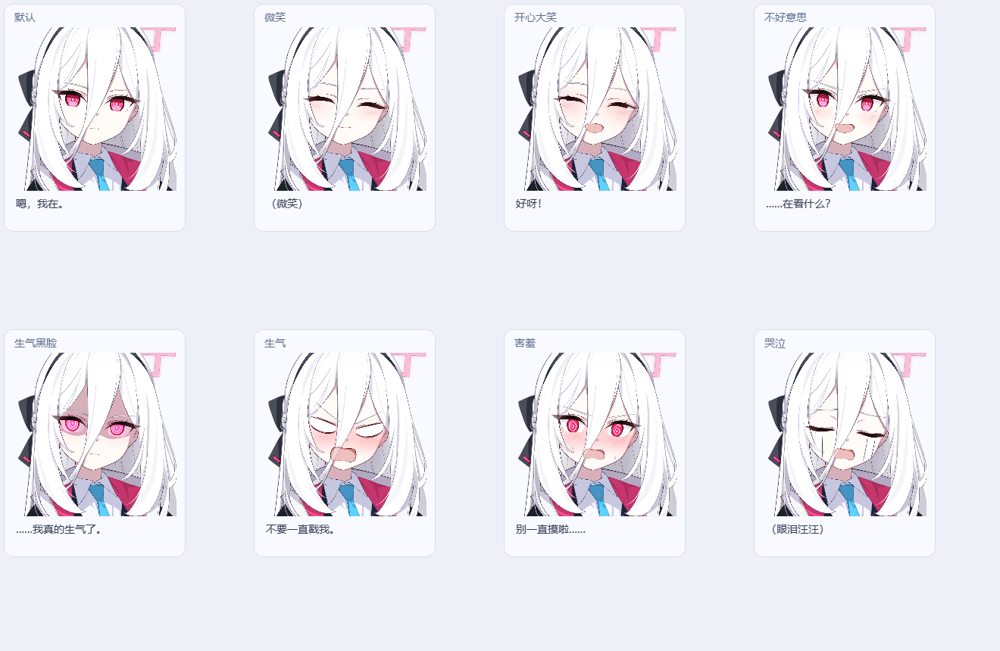

# 凯伊 Q版桌宠

基于 PySide6 的 Windows 桌面宠物：Q版立绘 + 原立绘差分图文反应 + 游戏原声语音，自带番茄钟、提醒、快捷工具与本地陪伴对话的助手面板。



## 功能

- **鼠标交互**：点击 / 双击 / 悬停 / 按住 / 连戳 / 拖拽 / 滚轮缩放，各有对应动作与反应。
- **图文反应卡片**：交互时在桌宠上方显示原立绘差分图片 + 反应台词（8 组表情，见 [操作说明](操作说明.md)）。
- **视频动作**：待机×2、待机动作、原地行走四组帧动画，右键可预览。
- **互动语音**：120+ 条 OGG 原声，按场景分类播放；差分表情与语音配对。
- **桌宠助手**：番茄钟、持久提醒、勿扰 / 免打扰时段、应用 / 文件 / 网页快捷工具、本地陪伴对话（节日与生日彩蛋，不接云端 AI）。

## 运行

```bash
pip install -r requirements.txt
python main.py        # 或双击 启动桌宠.bat
```

环境要求：Windows 10/11、Python 3.10+。关闭请通过托盘图标或右键菜单「退出」。

## 目录结构

```
main.py              入口
启动桌宠.bat          Windows 一键启动
pet/                 桌宠核心代码（窗口、动作、表情、语音、助手面板等）
tools/               测试与素材处理脚本
assets/
  animations/        视频帧动画（含 manifest 与 GIF 预览）
  layers/            Q版分层贴图
  differentials/     原立绘差分表情图（CH0335_spr_*.png）
  raw/               原始素材
  previews/          效果预览图
voices/              语音 OGG、清单 CSV 与分类指南
docs/                详细使用与设计文档
```

## 开发检查

```bash
python -I tools\test_expressions.py
python -I tools\test_behaviors.py
python -I tools\test_gestures.py
python -I tools\test_window.py
python -I tools\test_animations.py
```

更多说明见 [操作说明](操作说明.md) 与 [docs/](docs/)。

## 素材版权说明

本项目代码采用 MIT 许可证。`assets/` 中的角色立绘差分与 `voices/` 中的语音取自游戏《碧蓝档案》（Blue Archive），版权归其原权利方（Nexon Games / Yostar 等）所有，仅供个人学习与同人交流使用，请勿用于任何商业用途。游戏素材部分不适用 MIT 许可证。
