# KEI Assistant · 凯伊桌宠

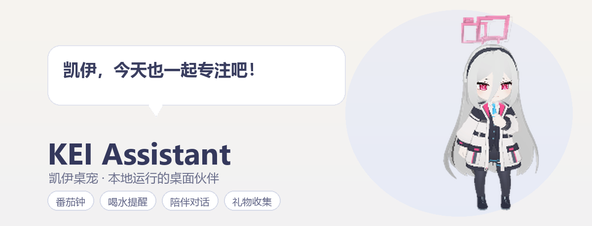

一个常驻 Windows 桌面的凯伊（Kei）桌宠：Q 版立绘在屏幕角落待机、跟着鼠标做反应，右键就能叫出番茄钟、事项提醒、快捷工作台和陪伴对话。日常点一点、聊两句、送个礼物，好感度会慢慢涨。

- **纯本地运行**：不联网、不接云端 AI，立绘、动画和语音全部随仓库分发。
- **桌面常驻**：透明无边框窗口，拖动 / 缩放 / 托盘菜单，位置和缩放自动记住。
- **顺手的小工具**：番茄钟、绝对与相对时间提醒、全屏时自动勿扰、应用 / 文件 / 文件夹 / 网页快捷入口。
- **会说话也会脸红**：152 条游戏原声 + 8 组原立绘差分的图文反应卡。
- **轻度养成**：好感度、喂食照顾、礼物图鉴、三款小游戏。

## 界面速览

| 专注空间 | 事项提醒 |
|---|---|
| 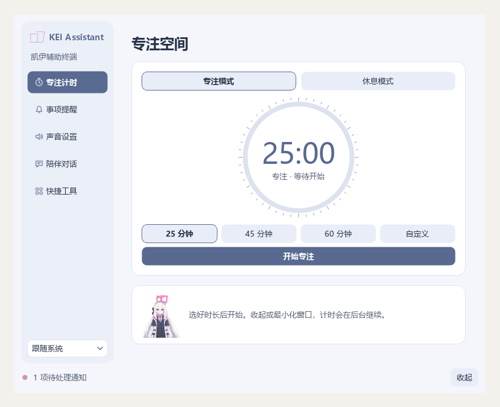 | 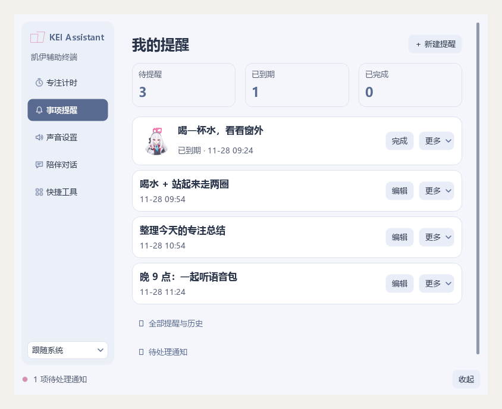 |

| 声音与勿扰 | 陪伴对话 |
|---|---|
| 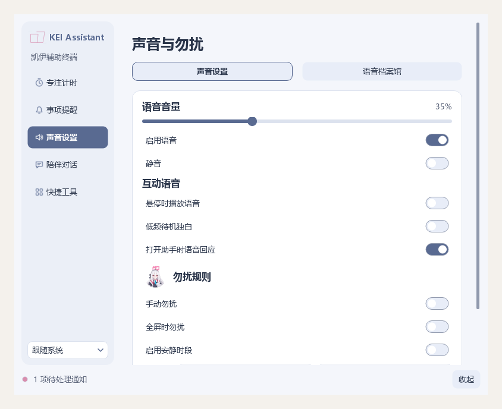 | 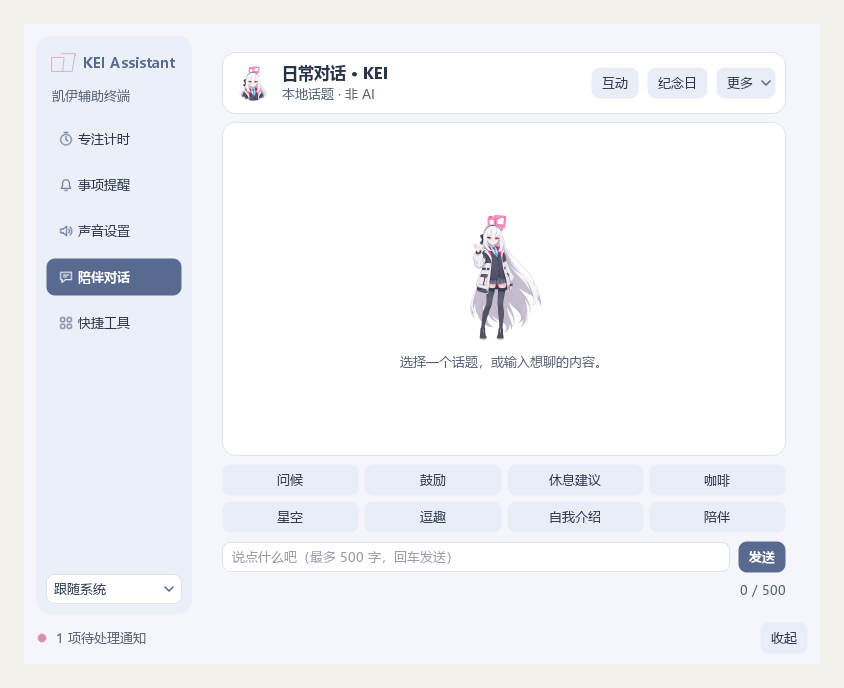 |

| 快捷工作台 | KEI 互动 · 喂食与照顾 |
|---|---|
| 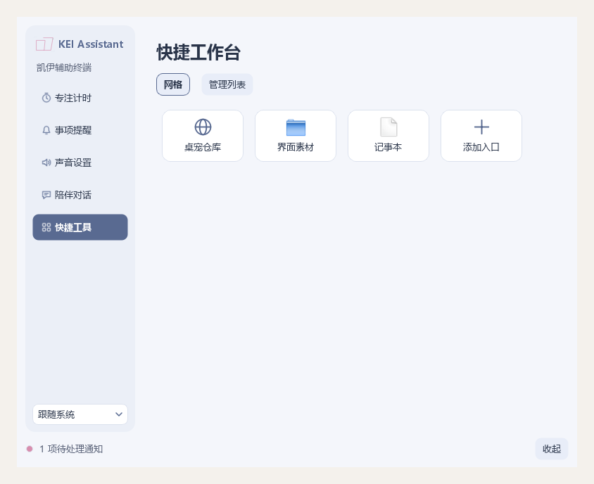 | 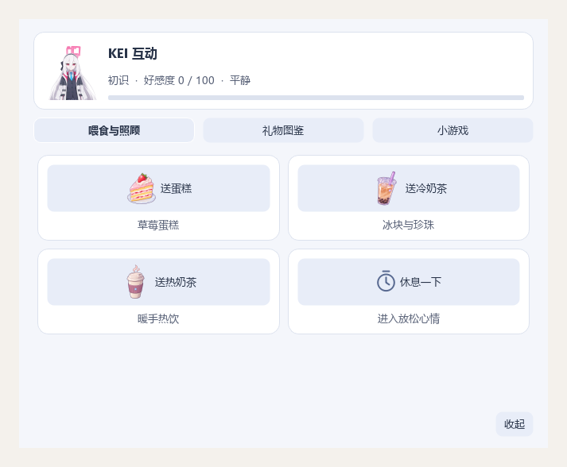 |

| 礼物图鉴 | 小游戏 |
|---|---|
| 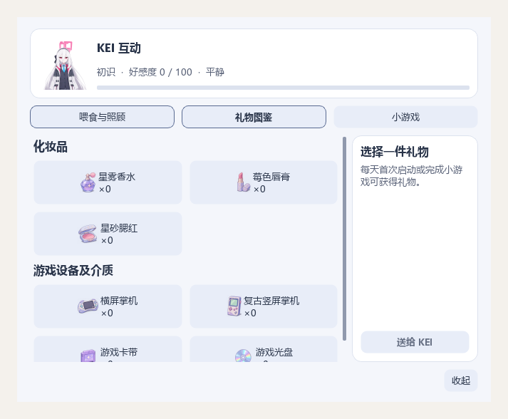 | 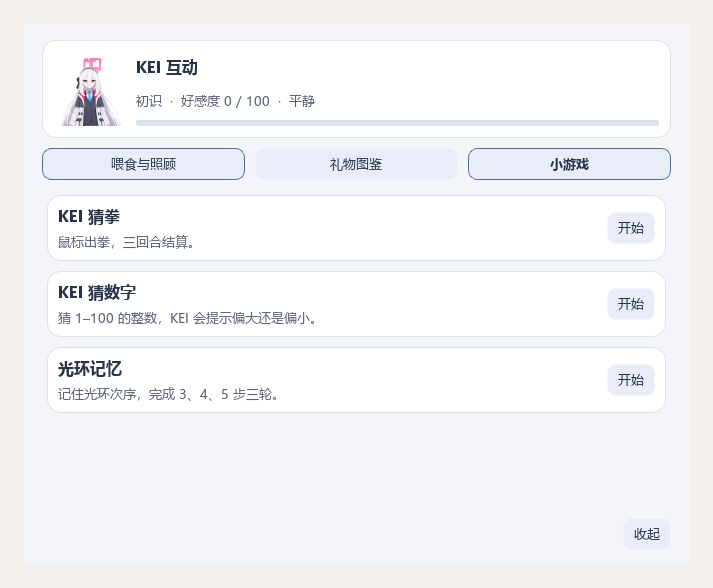 |

| 右键菜单 | 待处理通知 |
|---|---|
| 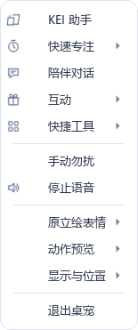 | 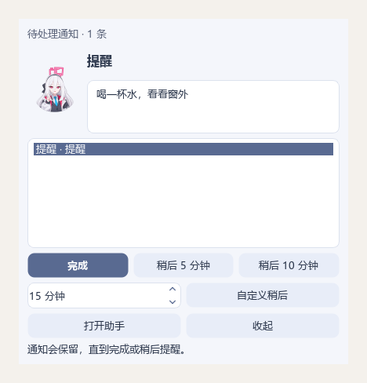 |

## 桌宠本体


Q 版立绘由分层贴图实时合成，待机时有轻微歪头、轻晃、呼吸和光环转动；四组原始序列帧（待机动画 2、待机动作、动作 1、原地行走）保留视频自带的表情与眨眼，不会在脸上叠画重绘的五官。

| 操作 | 反应 |
|---|---|
| 单击头部 | 微笑图文 + 歪头 |
| 单击身体 | 微笑图文 + 小跳 |
| 双击头部 | 开心图文 + 跳跃 |
| 双击身体 | 开心图文 + 约 10.7 秒动作 1 |
| 头部悬停约 1.5 秒 | 不好意思图文（每次进入最多一次） |
| 头部按住约 0.7 秒且不移动 | 害羞图文 + 轻晃 |
| 约 2.5 秒内连戳 4 / 7 次 | 生气 / 黑脸图文 |
| 拖拽 | 跟随、摆动与落地回弹 |
| 滚轮 | 缩放 |
| 右键 → 原立绘表情 | 手动查看 8 组图文反应 |

图文反应卡是原立绘差分图 + 台词，约 5 秒后收起；卡片不抢焦点、不挡鼠标，贴在角色可见范围正上方，屏幕上边不足时自动改放下方，并始终限制在屏幕内。

| 表情 | 默认 | 微笑 | 开心大笑 | 不好意思 | 生气黑脸 | 生气 | 害羞 | 哭泣 |
|---|---|---|---|---|---|---|---|---|
| 差分编号 | 01–05 | 07–10 | 14–15 | 12 | 23 | 24–25 | 26–28 | 29–31 |

## KEI 助手

右键「KEI 助手」打开终端，左侧五页：专注、提醒、声音 / 勿扰、陪伴对话、快捷工具。标题栏可最小化到任务栏，也可收起后从右键菜单恢复；计时与提醒在桌宠隐藏后继续走。

- **专注计时**：25 / 45 / 60 分钟或自定义，专注与休息两种模式，圆环显示剩余时间，结束时用语音和通知提醒。
- **事项提醒**：绝对时间或「多久之后」两套输入，支持编辑、完成、取消；到期后进入待处理列表，可以稍后 5 / 10 / 15 分钟或自定义顺延，通知会一直保留到完成或顺延。
- **声音与勿扰**：音量、语音开关、静音、悬停语音、低频待机独白、打开助手时的语音回应；勿扰支持手动开关、全屏自动勿扰和安静时段，只闭嘴不丢任务。
- **快捷工作台**：保存应用、文件、文件夹、网页四类入口，网格视图一键打开；已失效的路径会标出来，管理列表可编辑、排序、删除。
- **陪伴对话**：本地话题与关键词回应（问候 / 鼓励 / 休息建议 / 咖啡 / 星空 / 逗趣 / 自我介绍 / 陪伴），回复配原立绘与语音，另有元旦、万圣节、圣诞节和生日彩蛋。生日只保存月日，彩蛋尊重勿扰与专注状态、每天最多一次。

## KEI 互动

右键「互动」或陪伴对话顶部进入，三个分区：

- **喂食与照顾**：查看好感度与心情，送蛋糕、冷奶茶、热奶茶补充状态；好感度 0–100，分初识 / 熟悉 / 默契三档。
- **礼物图鉴**：每天首次启动自动入库一件礼物，完成小游戏可翻开三张礼物牌；礼物按化妆品、游戏设备及介质等分类收藏，也能送给凯伊。
- **小游戏**：猜拳（三回合结算）、猜数字（1–100，凯伊提示偏大偏小）、光环记忆（记住光环次序，3 / 4 / 5 步三轮），全部本地随机，无联网对战。

## 快速开始

环境要求：Windows 10 / 11、Python 3.10+。仓库已包含全部运行素材，克隆后即可运行。

```powershell
python -m pip install -r requirements.txt
python main.py
```

也可以双击 `启动桌宠.bat`。退出入口在系统托盘或右键菜单「退出桌宠」；程序用锁文件保证单实例，重复启动不会出现两只。

素材处理脚本（`tools/` 中的 `prepare_*` / `inspect_*`）另外需要 scipy、imageio 和 imageio-ffmpeg；运行时不解码源视频。

## 目录结构

```
main.py              入口（单实例锁 + 启动问候）
启动桌宠.bat          Windows 一键启动
pet/                 桌宠核心代码：窗口、动作、表情、语音、助手面板、互动、存储
tools/               单元测试与素材处理脚本
assets/
  animations/        四组序列帧 + 清单 + GIF 预览
  layers/            Q 版分层贴图
  differentials/     原立绘差分表情（CH0335_spr_*.png）
  character/kei/     助手界面角色图 + 清单
  interaction/kei/   礼物与食物图标
  ui/kei/            界面 SVG 图标
  raw/               分层素材原图
  previews/          效果预览图
voices/              152 条 OGG 原声、清单 CSV 与分类指南
docs/
  screenshots/       README 界面截图
  项目技术架构.md     模块划分、事件流、功能与代码入口对照
  快捷工具与陪伴对话使用说明.md
bubbles.json         台词表
```

## 数据与隐私

- 桌宠位置与偏好写入本机 `config.json`；计时、提醒、快捷入口、好感和礼物写入本机 `data/assistant.sqlite3`。
- 两者都在 `.gitignore` 中，不会进入仓库；仓库里没有任何账号、密钥或个人路径。
- 除主动打开网页快捷入口外，程序不发起网络请求，陪伴对话由本地话题表与关键词规则生成。
- 生日只保存「月-日」，不记录年份和其他个人信息。

## 开发自检

```powershell
python -m unittest discover -s tools -t . -p "test_*.py"
```

16 个测试模块、255 个用例，覆盖行为状态机、手势、动画、窗口交互、语音清单、助手服务、面板、互动、陪伴对话与快捷工具。测试需要创建临时目录，请在普通（非受限）环境下运行。

## 更多文档

- [操作说明](操作说明.md)：图文反应、鼠标交互、视频动作与素材预览。
- [项目技术架构](docs/项目技术架构.md)：技术栈、事件流、模块职责、功能与代码入口对照表。
- [快捷工具与陪伴对话使用说明](docs/快捷工具与陪伴对话使用说明.md)：快捷入口与本地对话的完整玩法。

## 素材版权说明

本项目代码采用 [MIT 许可证](LICENSE)。`assets/differentials/` 中的角色立绘差分与 `voices/` 中的语音取自游戏《碧蓝档案》（Blue Archive），版权归原权利方（Nexon Games / Yostar 等）所有；`assets/character/kei/`、`assets/interaction/kei/` 与 `assets/layers/` 中的角色图为用户自制。游戏素材仅供个人学习与同人交流使用，请勿用于任何商业用途。
